# AutomationWrapper
```
Wrapper+Automation/
├── Shared/
│   └── WorkflowContract.swift     JSON schema (Workflow, AutomationStep, ElementType, ActionType,
│                                   ConditionType, StepKind)
│                                   + WorkflowCodec (encode / decode / validate / versioning)
├── AuthoringTool/                 1. macOS SwiftUI drag & drop editor (sequence only, no screen mock-up) → writes workflow.json
│   ├── AuthoringTool.xcodeproj
│   └── AuthoringTool/  Domain/ · ViewModels/ · Repository/ · Views/
├── ExecutionTool/                 2. Headless runner: reads workflow.json, executes the steps in sequence
│   ├── ExecutionTool.xcodeproj    (one XCUITest bundle, no app / UI of its own)
│   ├── run_workflow.sh            command-line entry point
│   └── ExecutionTool/
│       ├── WorkflowRunner.swift   loads JSON → launches target app by bundle id → runs engine
│       ├── Engine/   WorkflowLoader (JSON decoder) → WorkflowEngine → ActionResolver → StepHandlers
│       ├── Driver/   UIAutomationDriver (abstraction) → XCUITestDriver (XCUIApplication)
│       └── Workflows/login_workflow.json   bundled sample
└── SampleTargetApp/               Demo "app under test" for the login example (optional)
    ├── SampleLoginApp.xcodeproj
    ├── install_on_simulator.sh
    └── SampleLoginApp/
```
Requirements: Xcode 15 or later, macOS 13+, an iOS 16+ iPhone simulator.

## How it works

AutomationWrapper has two halves that share one JSON contract (`Shared/WorkflowContract.swift`).
The **Authoring Tool** (macOS) writes `workflow.json`. The **Execution Tool** (headless XCUITest)
reads it and drives an app that is already installed on an iOS Simulator.

**Colour key** (used in every diagram below):

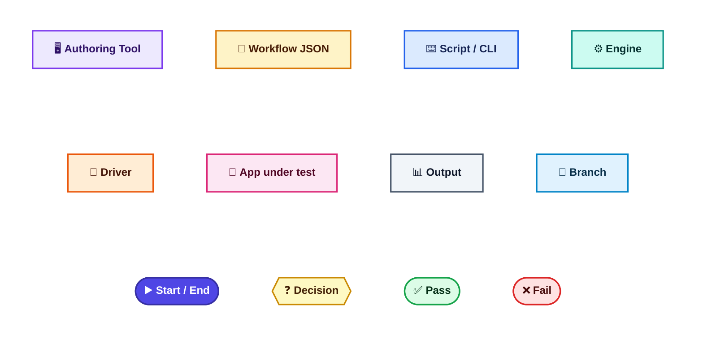

Thick indigo arrows show the main path, green arrows lead to a pass, red arrows lead to a failure.

### 1. The big picture

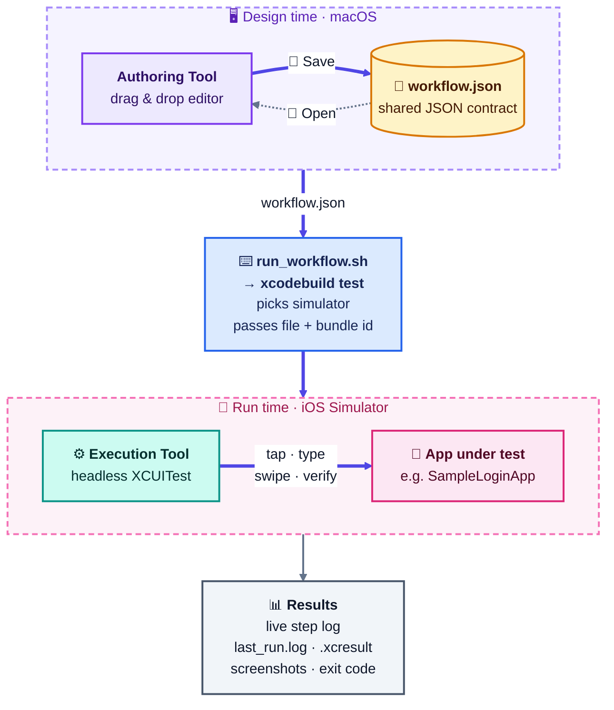

Both Xcode projects compile the same `WorkflowContract.swift`, so the writer and the reader can never
disagree about the JSON format.

### 2. End-to-end flow

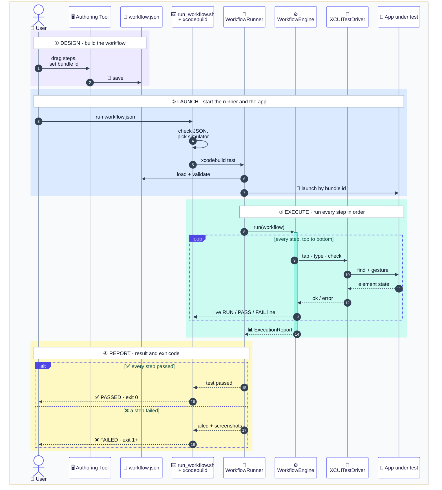

### 3. Inside the Authoring Tool

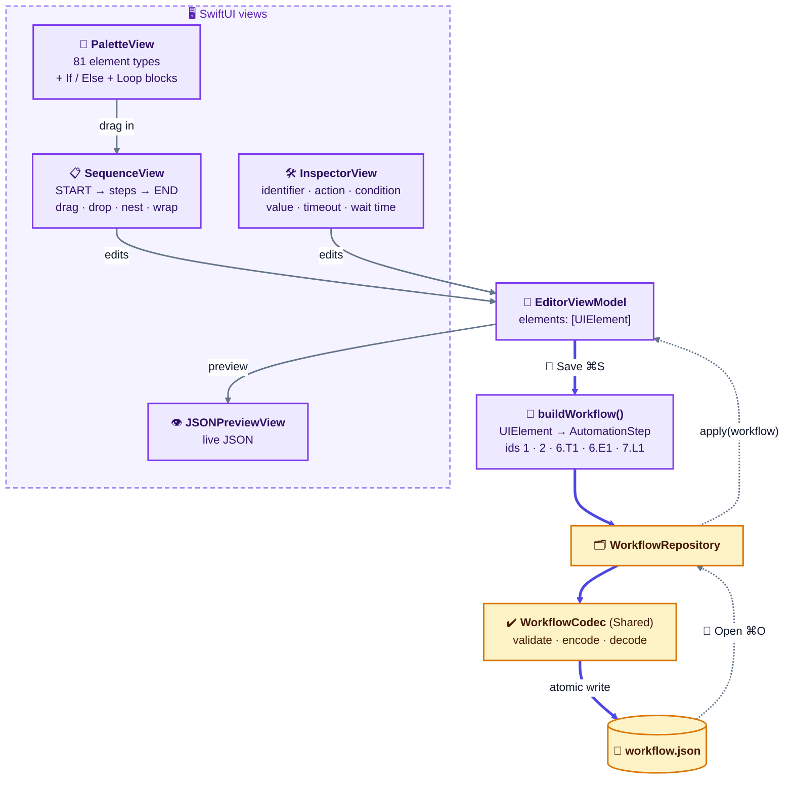

### 4. What `run_workflow.sh` does

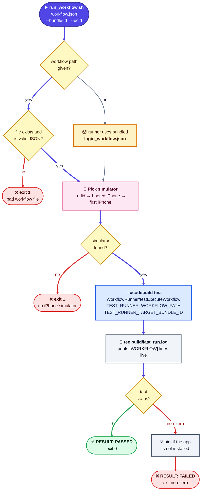

### 5. Inside the Execution Tool

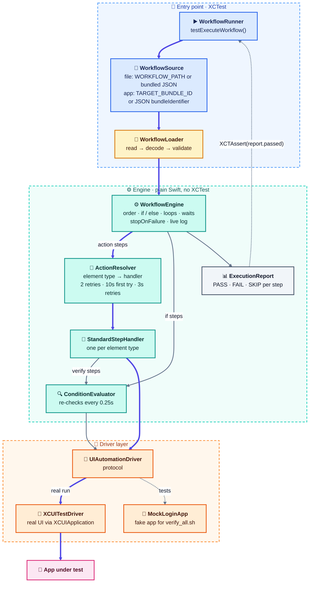

Everything in the engine box is plain Swift with no XCTest dependency. That is why `verify_all.sh` can run
the whole engine against `MockLoginApp` without a simulator, and why another backend (for example Appium)
only needs a new `UIAutomationDriver`.

### 6. How the engine runs each step

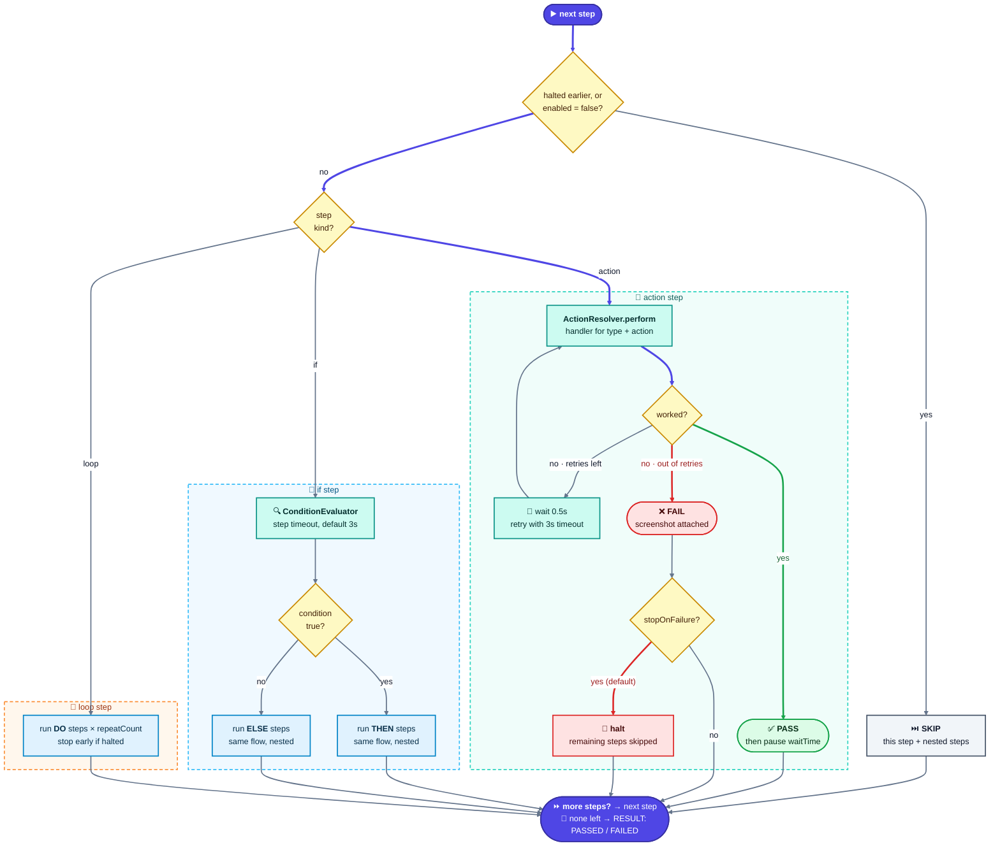

### 7. How a condition is checked (`verify` and `if`)

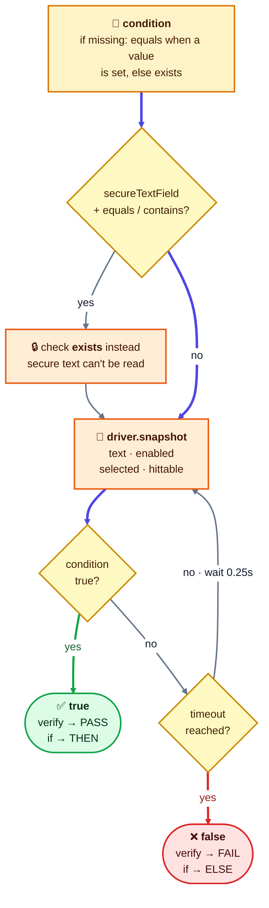

### 8. How `XCUITestDriver` finds an element

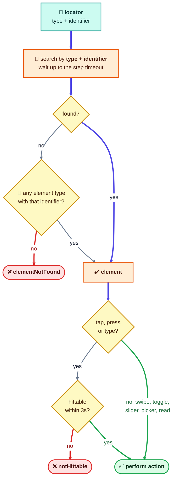

The fallback means a step still works when the app exposes an element with a different type than the
one chosen in the editor, as long as the accessibility identifier matches.

### 9. Example: the login workflow

`workflow_if_else_example.json` (and the Authoring Tool's Login Sample) runs like this against
`SampleLoginApp`:

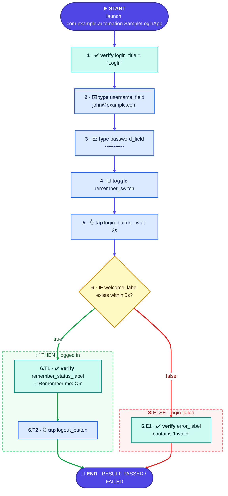

Blue boxes act on the app, teal boxes check it.

### 10. The JSON model

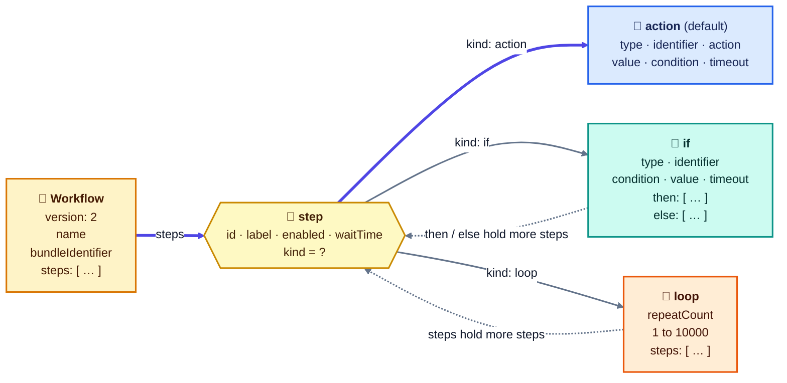

Only `id` is always required. Action and `if` steps also need `type` and `identifier`; loop steps need
`repeatCount`. `WorkflowCodec.validate` rejects files with a `version` above 2, duplicate step ids, empty
identifiers, actions the element type does not support, and missing or out-of-range values.

### 11. What `verify_all.sh` checks

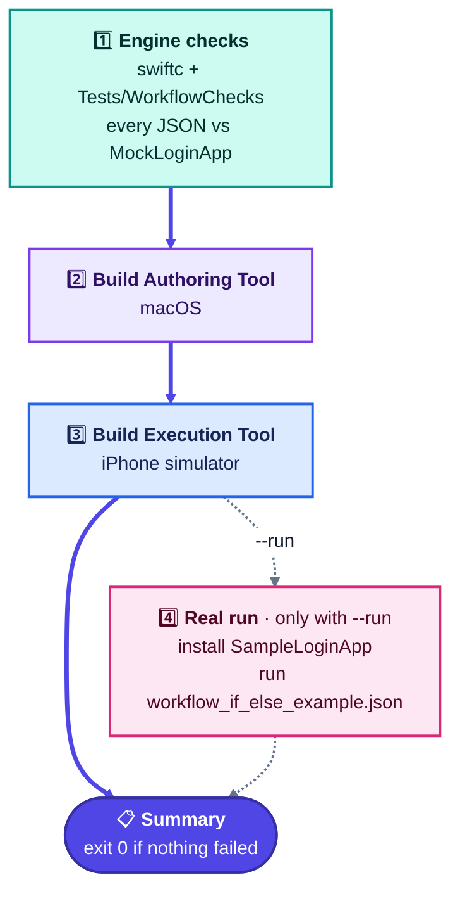

## 1. Authoring Tool

Open `AuthoringTool/AuthoringTool.xcodeproj` and run it on **My Mac**. The Login sample is loaded on launch.

- The palette lists **every XCUIElement type** (81, grouped and searchable) plus an **If / Else** logic block.
- The design area has no screen mock-up: it is the **execution sequence** itself, a vertical list of step
  cards from START to END that run top to bottom. Drag elements from the palette into it (or double-click a
  palette item to add it at the end).
- Edit the selected step in the **Properties Inspector**: element type, identifier, action, verify condition,
  value, timeout, wait time.
- The sequence is fully drag & drop. The order is the execution order:
  - drag a row to reorder it; drop it on another row to insert before that row
  - drag rows (or palette items) onto a block's **THEN** / **ELSE** header to put them in that branch, and
    drag them back out the same way. Whole If / Else blocks can be dragged and nested.
  - right-click a row: Duplicate, Wrap in If / Else, Enable / Disable, Move, Delete
- **If / Else block:** pick the element to check and a condition (Exists, Does Not Exist, Text Equals,
  Text Contains, Is Enabled / Disabled, Is Selected / On, Is Not Selected / Off, Is Hittable) and an optional
  timeout. THEN steps run when it is true, ELSE steps when it is false.
  *Wrap in If / Else* (⌥⌘I) turns "tap X" into "if X exists → tap X".
- **Loop block (for loop):** repeats the steps in its **DO** section N times (set REPEAT in the block or the
  inspector). *Wrap in Loop* repeats an existing step. Loops and If / Else blocks can be nested in each other.
- **Rename any step:** double-click it (or right-click → Rename…, or *Step Name* in the inspector). The name is
  saved as `label`.
- **Minimize / expand:** the chevron on an If / Else or Loop card hides or shows its contents
  ("3 steps hidden"). The buttons in the design area header (or ⌥⌘← / ⌥⌘→) minimize / expand all blocks.
- Set **App bundle identifier** in the toolbar. It tells the Execution Tool which app to drive.
- **Save** (⌘S) writes `workflow.json`. **Open** (⌘O) imports one back.

## 2. Execution Tool (headless)

The Execution Tool has no UI. It launches an app that is **already installed** on the simulator
(`XCUIApplication(bundleIdentifier:)`) and executes the workflow steps in order.

```bash
# one-time: install the demo login app on the simulator
SampleTargetApp/install_on_simulator.sh

# run the bundled login workflow
ExecutionTool/run_workflow.sh

# run a workflow saved by the Authoring Tool
ExecutionTool/run_workflow.sh ~/Desktop/workflow.json

# drive a different app than the JSON says, or pick a simulator
ExecutionTool/run_workflow.sh ~/Desktop/workflow.json --bundle-id com.mycompany.MyApp --udid <SIMULATOR-UDID>
```

Output is the live execution sequence:

```
Executing 'Login Flow with If / Else' – 6 steps (+3 inside if/else)
[1] RUN   verify staticText 'login_title' equals "Login"
[1] PASS  verify staticText 'login_title' equals "Login" (1.3s)
[2] RUN   typeText textField 'username_field' = "john@example.com"
[2] PASS  typeText textField 'username_field' = "john@example.com" (2.4s)
[3] RUN   typeText secureTextField 'password_field' = "•••••••••••"
...
[6] IF    staticText 'welcome_label' exists
[6] TRUE  staticText 'welcome_label' exists → THEN (2 steps)
  [6.T1] RUN   verify staticText 'remember_status_label' equals "Remember me: On"
  [6.T1] PASS  verify staticText 'remember_status_label' equals "Remember me: On" (0.4s)
  [6.T2] RUN   tap button 'logout_button'
  ...
[6] END IF
RESULT: PASSED
```

The script exits 0 on pass and non-zero on failure, so it can run in CI. The full log is in
`ExecutionTool/build/last_run.log`. The `.xcresult` bundle holds the per-step activities and failure screenshots.

**From Xcode instead:** open `ExecutionTool.xcodeproj`, select an iPhone simulator, and press ⌘U. To run your
own file, go to Edit Scheme → Test → Arguments and enable `WORKFLOW_PATH`.

### Which app and which file
| input              | source                                                                 |
|--------------------|------------------------------------------------------------------------|
| workflow file      | `WORKFLOW_PATH` (set by the script), else bundled `login_workflow.json` |
| target app         | `TARGET_BUNDLE_ID` (`--bundle-id`), else `"bundleIdentifier"` in JSON   |
| simulator          | `--udid`, else the booted iPhone, else the first available iPhone       |

The target app must already be installed on the simulator you run against. For your own app, run it once
from Xcode on that simulator, or use `xcrun simctl install <udid> MyApp.app`.

## Checking everything works

```bash
./verify_all.sh          # JSON + engine checks, build Authoring Tool, build Execution Tool
./verify_all.sh --run    # …and run workflow_if_else_example.json on the simulator
```

Step 1 compiles `Shared/` + the Execution Tool engine + the Authoring Tool model with `swiftc` and runs
`Tests/WorkflowChecks` against every workflow JSON (a mock login app stands in for the simulator).
Logs go to `build/verify/`.

## Login scenario

| # | type            | identifier              | action   | value            | wait |
|---|-----------------|-------------------------|----------|------------------|------|
| 1 | staticText      | `login_title`           | verify   | Login            | 1    |
| 2 | textField       | `username_field`        | typeText | john@example.com | 1    |
| 3 | secureTextField | `password_field`        | typeText | password123      | 1    |
| 4 | switch          | `remember_switch`       | toggle   |                  | 1    |
| 5 | button          | `login_button`          | tap      |                  | 2    |
| 6 | **if** staticText `welcome_label` exists (timeout 5) |  |  |  |  |
| 6.T1 | staticText   | `remember_status_label` | verify equals   | Remember me: On |  |
| 6.T2 | button       | `logout_button`         | tap             |                 | 1 |
| 6.E1 | staticText   | `error_label`           | verify contains | Invalid         |  |

The bundled `login_workflow.json` is the original flat version (6 = verify `welcome_label`,
7 = verify `remember_status_label`); the Authoring Tool's Login Sample and `workflow_if_else_example.json`
use the If / Else version above.

## JSON contract

```json
{
  "version": 2,
  "name": "Login Flow",
  "bundleIdentifier": "com.example.automation.SampleLoginApp",
  "steps": [
    { "id": "1", "type": "staticText", "identifier": "login_title", "action": "verify", "condition": "equals", "value": "Login" },
    { "id": "5", "type": "button", "identifier": "login_button", "action": "tap", "waitTime": 2 },
    { "id": "6", "kind": "if", "type": "staticText", "identifier": "welcome_label", "condition": "exists", "timeout": 5,
      "then": [ { "id": "6.T1", "type": "button", "identifier": "logout_button", "action": "tap" } ],
      "else": [ { "id": "6.E1", "type": "staticText", "identifier": "error_label", "action": "verify", "condition": "contains", "value": "Invalid" } ] }
  ]
}
```

A loop step:

```json
{ "id": "7", "kind": "loop", "label": "Scroll the list", "repeatCount": 3,
  "steps": [ { "id": "7.L1", "type": "table", "identifier": "items_table", "action": "swipeUp" } ] }
```

A full example is in `workflow_if_else_example.json`.

| field              | meaning                                                                                |
|--------------------|----------------------------------------------------------------------------------------|
| `bundleIdentifier` | app to drive (optional if passed with `--bundle-id`)                                   |
| `kind`             | `action` (default), `if` or `loop`                                                     |
| `type`             | any `XCUIElement.ElementType` name: `button`, `staticText`, `textField`, `switch`, `cell`, `slider`, `pickerWheel`, `alert`, `navigationBar`, `any`, … (81 types) |
| `identifier`       | accessibility identifier in the target app                                             |
| `action`           | `tap`, `doubleTap`, `longPress`, `twoFingerTap`, `typeText`, `clearText`, `toggle`, `adjustSlider`, `selectPickerValue`, `swipeUp/Down/Left/Right`, `verify` (optional; defaults per type) |
| `condition`        | for `verify` and `if`: `exists`, `notExists`, `equals`, `contains`, `enabled`, `disabled`, `selected`, `notSelected`, `hittable`. Missing = `equals` if there is a value, else `exists` |
| `value`            | text to type, expected text, long-press seconds, slider position 0–1, or picker value  |
| `timeout`          | seconds to wait for the element / condition (default 10 for actions, 3 for `if`)       |
| `then` / `else`    | `if` steps only: steps to run when the condition is true / false (can be nested)       |
| `repeatCount` / `steps` | `loop` steps only: run `steps` this many times (1–10000). Loops have no `type` / `identifier` |
| `label`, `collapsed` | step name and minimized state in the editor; ignored by the Execution Tool          |
| `waitTime`         | seconds to pause after the step succeeds                                               |
| `label`            | editor display name; ignored by the Execution Tool (`position` from older files is ignored too) |
| `enabled`          | `false` skips the step                                                                 |

Files with a `version` higher than `Workflow.currentVersion` (2) are rejected. Version 1 files still load.
Step ids must be unique across the whole tree; the Authoring Tool numbers nested steps `6.T1`, `6.E1`, `7.L1`, `6.T1.E2`, ….

## Extending

- **Element types:** every `XCUIElement.ElementType` is already in `ElementType` (Shared) and mapped in
  `XCUITestDriver` (`ElementType.xcuiType`). All of them use `StandardStepHandler`; to customise one, write a
  `StepHandler` and replace its entry in `ActionResolver.standard()`.
- **New action:** add a case to `ActionType` (Shared), handle it in `StandardStepHandler`, and, if it needs a new
  gesture, in `UIAutomationDriver` / `XCUITestDriver`.
- **Conditions:** `ConditionEvaluator` polls `UIAutomationDriver.snapshot(_:)` until the condition is true or
  the timeout runs out. `if` steps use it to choose a branch, `verify` steps to pass or fail.
- **Other backend:** implement `UIAutomationDriver` and pass it to `WorkflowEngine`.
- **Retries / timeouts:** `ActionResolver` (`maxRetries`, `elementTimeout`, `retryTimeout`).
- **Run every step even after a failure:** `WorkflowEngine(stopOnFailure: false)`.
